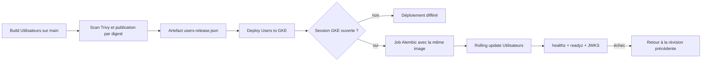

# SCRUM-48 — Déploiement continu sur GKE

## Périmètre livré et dépendances

Cette livraison met en place le chemin réel pour **Utilisateurs** et le socle
d'identité/RBAC réutilisable. SCRUM-48 reste ouvert : il couvre quatre Deployments.

| Workload | Image et commande disponibles | Suite |
| --- | --- | --- |
| Utilisateurs | Image SCRUM-43, FastAPI/uvicorn | Migration, rollout et smoke test dans cette PR |
| Ingestion | Dépend de SCRUM-51 et SCRUM-114 | Ajouter son manifest et sa livraison quand l'image existe |
| Analytique API | Dépôt encore vide au précontrôle du 24/11 | SCRUM-77 et SCRUM-115 |
| Analytique worker | Même future image que l'API, autre commande | SCRUM-57/115 et RabbitMQ SCRUM-50 |

Le worker n'aura ni Service métier ni Ingress. L'installation KEDA et son
ScaledObject restent dans SCRUM-102/65. Gateway, routage externe et certificats
restent dans SCRUM-54/55. Aucun faux déploiement des services indisponibles.

## Comment fonctionne la livraison



1. `build-images.yml` construit le main Utilisateurs et scanne l'image avant et
   après publication. Après le dernier scan réussi, il publie un petit artefact
   `users-release` (90 jours), avec image par digest, SHA applicatif, SHA
   Infrastructure et ID du run.
2. Le succès de ce workflow sur main déclenche `deploy-users.yml`. Un run de PR,
   fork, autre workflow, branche différente ou artefact ne correspondant pas au
   run est rejeté. La vérification Docker relit les labels OCI source/révision.
3. Si GKE est absent, un déclenchement automatique est différé avec une note
   dans le résumé. La CI n'allume ni GKE ni SQL. Un lancement manuel pendant une
   session permet de déployer le digest choisi ou de revenir à une ancienne image.
4. Un Job `users-migrate-*` applique `alembic upgrade head` avec le rôle SQL du
   service. L'application conserve `RUN_MIGRATIONS=false`. Le Job doit réussir
   avant toute modification du Deployment ; il est supprimé après le contrôle.
5. La même image est déployée avec une mise à jour progressive (un Pod reste
   disponible). Le workflow attend le rollout et teste `/healthz`, `/readyz`
   (PostgreSQL accessible) et `/.well-known/jwks.json` (RS256), par port-forward
   local au runner. Aucun LoadBalancer public n'est créé.
6. Si le rollout ou le smoke test échoue, la révision précédente du Deployment
   est restaurée si elle existe. Les migrations SQL ne sont jamais rétrogradées
   automatiquement : les migrations doivent rester compatibles avec l'image
   précédente. Au premier déploiement, il n'existe aucune révision à restaurer.

Un push dans Utilisateurs ne lance pas encore le workflow central : lancer
`Images Docker (SCRUM-43)` sur main Infrastructure pour publier puis déclencher
la livraison. Après fusion de cette PR, la chaîne automatique utilise le nouvel
artefact ; les anciens runs de build ne possèdent pas cet artefact.

## Identités, réseau et secrets

- Build : `bv-dev-users-build`, publication au registre seulement (SCRUM-43).
- Smoke SCRUM-108 : identité existante inchangée, lecture des nœuds seulement.
- Livraison : `bv-dev-gke-release`, fournisseur OIDC `gke-release` limité au dépôt,
  aux branches explicites et à `deploy-users.yml`. IAM autorise seulement la
  connexion/lecture du cluster et la lecture du registre. Les écritures passent
  par le Role Kubernetes du seul namespace `bodyvision`.
- La CI ne crée ni namespace, ni Role/RoleBinding, ni compte de service ; elle
  ne lit pas les Secrets Kubernetes et n'a pas de permission `pods/exec`.
  Le bootstrap de ces ressources se fait une fois par session, par l'opérateur.
- Le KSA `users` utilise le GSA SQL préparé par SCRUM-49. Le proxy Cloud SQL
  officiel 2.28.1, épinglé par digest, est un sidecar natif : il démarre avant
  l'application et s'arrête quand le Job de migration termine. Il joint SQL en
  IP privée sur TCP 3307 avec TLS ; l'application utilise son loopback TCP 5432.
- Le composant Secret Manager CSI géré est activé sur GKE. Le KSA `users` lit
  uniquement ses trois secrets via Workload Identity ; les valeurs sont montées
  en fichiers, sans Kubernetes Secret et sans passage dans le state Terraform.
  Le wrapper transmet les deux valeurs requises en environnement au processus
  applicatif et lui donne le chemin du PEM JWT.
- Mot de passe SQL existant SCRUM-49 ; token interne et clé RSA sont initialisés
  hors Terraform par `scripts/bootstrap-users-secrets.ps1`, sans affichage ni
  rotation lors d'une réexécution. Les versions sont épinglées à **1** dans le
  SecretProviderClass. Une rotation exige une mise à jour explicite de la version
  et un rollout ; la clé JWT ne change pas à chaque recréation de Pod/cluster.
- Pods sans privilèges, filesystem racine en lecture seule, ressources bornées,
  probes et Network Policies avant les workloads. Les labels restent ceux du
  contrat SCRUM-66. Le Service Utilisateurs est interne (`ClusterIP`).

## Préparer une session dev (opérateur)

Depuis un checkout revu, vérifier projet `bodyvision-509616`, backends et
workspace `default`. La session de preuve utilise une zone et un seul nœud ; les
valeurs Terraform par défaut ne sont pas une consigne de dimensionnement économique.

```powershell
./scripts/bootstrap-users-secrets.ps1
gcloud sql instances patch bodyvision-dev-postgres --project=bodyvision-509616 --activation-policy=ALWAYS --quiet
gcloud sql instances describe bodyvision-dev-postgres --project=bodyvision-509616 --format="yaml(state,settings.activationPolicy)"
```

Attendre **RUNNABLE / ALWAYS avant de planifier persistent** (voir SCRUM-49).
Initialiser, relire puis appliquer le plan complet persistent : les nouvelles
ressources attendues sont uniquement l'identité OIDC/IAM de livraison et son accès
en lecture au registre. Aucun changement SQL/réseau ni suppression n'est attendu.
Initialiser ensuite dev, relire son plan complet et l'appliquer pour la session.
Les deux nouveaux secrets doivent exister avant la création de leurs droits IAM.

Utiliser un kubeconfig temporaire, puis installer les ressources d'opérateur :

```powershell
$env:KUBECONFIG = Join-Path $env:TEMP 'bodyvision-scrum48-kubeconfig'
gcloud container clusters get-credentials bodyvision-dev-gke --project=bodyvision-509616 --region=europe-west9 --dns-endpoint
kubectl config current-context
kubectl apply -k infra/kubernetes/bootstrap-dev
kubectl -n bodyvision get serviceaccount,secretproviderclass,role,rolebinding,networkpolicy
```

Ces manifests sont propres au projet dev : ne pas les utiliser pour prod. Le
compte de livraison ne peut pas exécuter le bootstrap à la place de l'opérateur.
Après un destroy dev, il faut recréer ce bootstrap dans le nouveau cluster.

## Déclencher et diagnostiquer

Dans Actions, `Deploy Users to GKE` → `Run workflow` → branche main →
`image_digest = sha256:<64 caractères hexadécimaux>`. La même commande permet un
retour explicite à une ancienne image compatible avec le schéma actuel.

Le résumé du run donne le digest et le SHA source. Pour un contrôle opérateur :

```powershell
kubectl -n bodyvision rollout status deployment/users --timeout=300s
kubectl -n bodyvision get deployment,pods,service
kubectl -n bodyvision get events --sort-by=.lastTimestamp
kubectl -n bodyvision logs deployment/users -c users --tail=50
kubectl -n bodyvision logs deployment/users -c cloud-sql-proxy --tail=50
```

Si le volume CSI échoue, vérifier le composant GKE, le KSA et ses droits sur les
versions épinglées. Si le proxy échoue : identité SQL/WIF, API Cloud SQL, instance
démarrée et règle /32 TCP 3307. Si la migration échoue, le Deployment existant est
conservé ; corriger la cause puis relancer. Ne pas afficher les valeurs de secrets
ou l'environnement complet des conteneurs dans les preuves du ticket.

## Fermer la session et preuves

Relire puis appliquer un **plan destroy de dev seulement**, avec les mêmes
variables de session. Vérifier qu'il ne touche ni Cloud SQL, ni VPC, ni registre,
ni secrets durables. Arrêter ensuite SQL via gcloud et confirmer STOPPED / NEVER.
Ne jamais détruire persistent pour arrêter GKE. Le stockage/sauvegardes SQL et les
autres ressources durables restent facturables ; recontrôler VM et IP NAT allouées.

Pour la preuve de branche, autoriser temporairement sa ref exacte dans
`gke_release_allowed_refs`, puis retirer cette autorisation et le déclencheur
de preuve après le test. Le code par défaut autorise main seulement. Fusionner
cette PR avant un autre apply persistent depuis main, pour conserver la nouvelle
identité déjà appliquée pendant la preuve.

Consigner dans SCRUM-48 : PR/commits, plans, run GitHub, digest/SHA source, Job de
migration, rollout/probes/JWKS, contrôle RBAC et résultat du nettoyage. La réussite
d'Utilisateurs ne constitue pas une validation des trois autres Deployments.

Sources : [Secret Manager CSI](https://cloud.google.com/secret-manager/docs/secret-manager-managed-csi-component),
[Cloud SQL Proxy 2.28.1](https://github.com/GoogleCloudPlatform/cloud-sql-proxy/releases/tag/v2.28.1).
